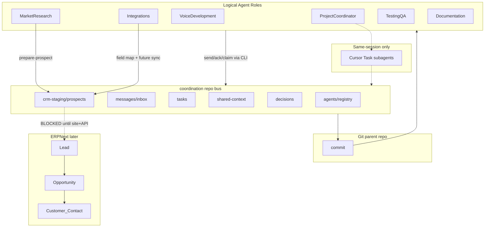

# Coordination Architecture

**Selected:** Hybrid Option B (repository bus) primary + Option A (Cursor Task) secondary + Option C (MCP memory) deferred + ERPNext staging (sync deferred).

## Decision

| Option | Verdict | Reason |
|---|---|---|
| A — Native Cursor only | Rejected as primary | No cross-session message delivery |
| B — Repository-based | **Selected** | Works across chats/sessions via git files; no new services |
| C — MCP communication | Deferred | Supermemory/Adapter unauthenticated |
| D — External orchestration | Rejected | Unnecessary operational overhead |
| ERPNext live sync | Deferred / BLOCKED | No site installed; stage packages now |

## Delivery honesty

Messages are **not** real-time. Recipients discover work by polling `messages/inbox/` (CLI or session startup rule). Acknowledgment is a recorded status transition, not proof of task completion.

## Concurrency limitation

Ordinary JSON/Markdown files do not provide strong atomic locks. Duplicate claims are detected best-effort by the CLI. Coordinator-mediated assignment is required when conflicts appear.

## Diagram

## Message lifecycle

Valid transitions:

- `PROPOSED` → `ACKNOWLEDGED` | `REJECTED` | `CANCELLED`
- `ACKNOWLEDGED` → `IN_PROGRESS` | `BLOCKED` | `REJECTED` | `CANCELLED`
- `IN_PROGRESS` → `COMPLETED` | `BLOCKED` | `CANCELLED`
- `BLOCKED` → `IN_PROGRESS` | `CANCELLED` | `REJECTED`

Evidence required:

- `ACKNOWLEDGED`: `ack.agent` + `ack.at`
- `IN_PROGRESS`: claim or `ack` present
- `COMPLETED`: `resolution.summary` + `resolution.at`
- `BLOCKED`: `resolution.blocker` reason

## ERPNext staging

Internal packages under `crm-staging/prospects/` map to Lead → Opportunity → Customer/Contact.  
`export-erpnext` writes REST-shaped payloads locally.  
`sync-erpnext` fails closed until site URL + API credentials are configured.

Docs basis: ERPNext CRM workflow (Lead → Opportunity → Quotation → Customer → Sales Order).

## Git visibility

Uncommitted coordination files are **not** shared across worktrees. Commit (and pull elsewhere) before assuming another session can see them.
