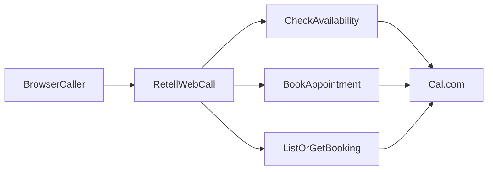
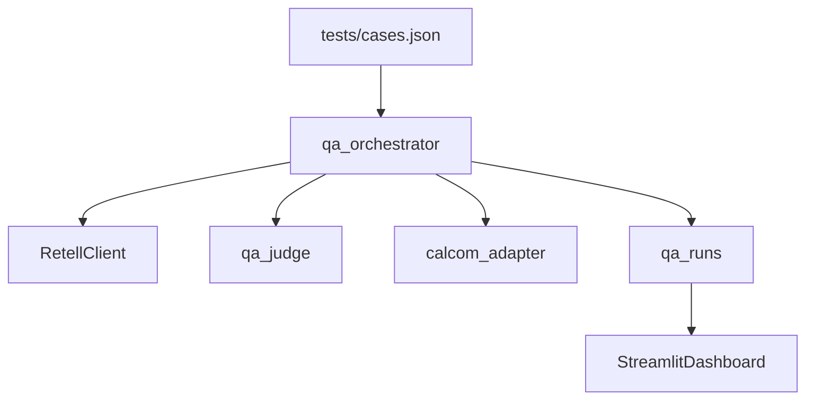

# System Architecture

| Field | Value |
|---|---|
| Owner | voice-development (product) / documentation (doc integrity) |
| Status | NEEDS_REVIEW |
| Last verified | 2026-11-18 |

## Demo path (verified design)

No custom application backend is required for the native Retell + Cal.com path. Source: `voice-agent/README.md`.

## QA auditor (separate)

The QA suite must **not** rebuild the production receptionist. Safety defaults fail closed (`ACK_TARGET_NUMBER=NO`, `ALLOW_SANDBOX_WRITES=NO`).

## Coordination

Logical agents exchange JSON messages under `coordination/messages/`. Delivery is asynchronous via git + inbox polling. See `coordination/architecture.md`.

## Persistence

| Data | Store |
|---|---|
| Demo bookings | Cal.com |
| QA evidence | local `qa_runs/` (not a production DB) |
| Agent handoffs | git files under `coordination/` |
| Secrets | local `.env` / operator vault — never git |

## Failure / fallback (high level)

- Missing credentials → QA reports BLOCKED, not fabricated PASS.
- Cal.com/Retell outage → demo/QA fail; escalate per operations runbook.
- ERPNext unavailable → keep crm-staging export only.
