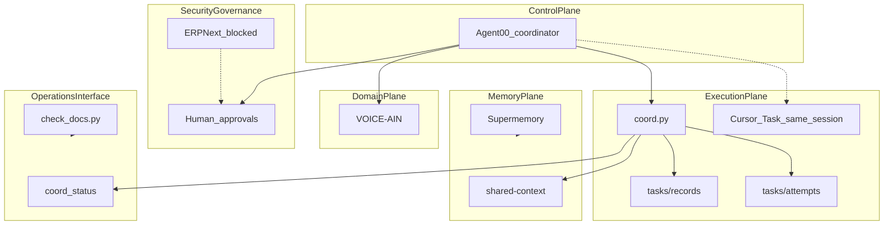

# UAN-CORE Architecture (Implemented on Repo Bus)

| Field | Value |
|---|---|
| UAN core version | 0.1.0 |
| Domain pack | VOICE-AIN (`voice_agent_network`) |
| Authority | `coordination/` + `coordination/scripts/coord.py` |
| Decision | ADR-002 |

## Principle

**Build the core once. Specialize through domain packs.**

This workspace implements UAN-CORE by **evolving** the existing repository coordination bus. It does **not** introduce a parallel `src/uan/` runtime.

## Layers

## Interfaces

| Interface | Contract | Store |
|---|---|---|
| Messages | `schemas/message.schema.json` | `messages/inbox|archive` |
| Tasks | `schemas/task.schema.json` | `tasks/records` |
| Handoffs | `schemas/handoff.schema.json` | `handoffs/*.json` |
| Config | `config/uan.json` | aliases, routes, concurrency |
| Domain | `domains/voice_agent_network/domain.yaml` | VOICE-AIN metadata |

## Non-claims

- Not a continuously running multi-agent OS.
- Not production deploy automation.
- Not a replacement for Retell/Cal.com provider consoles.
